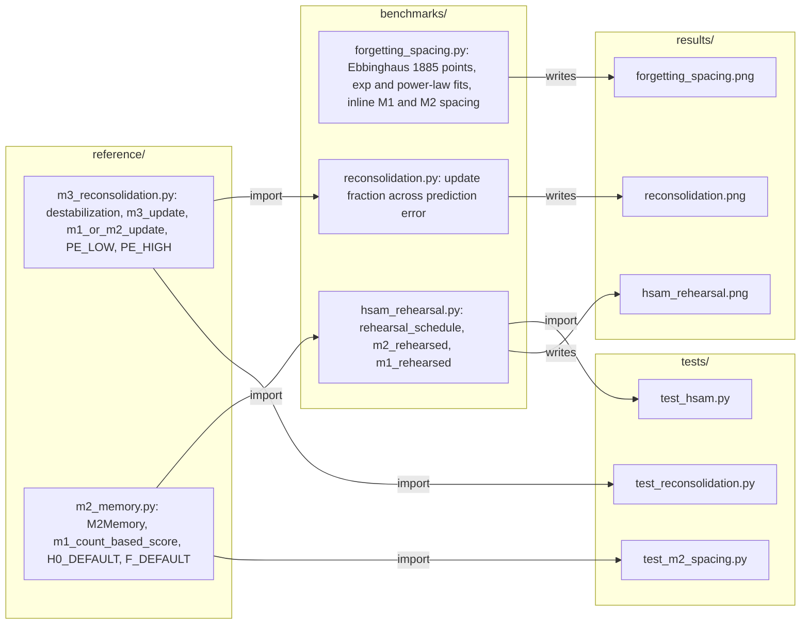
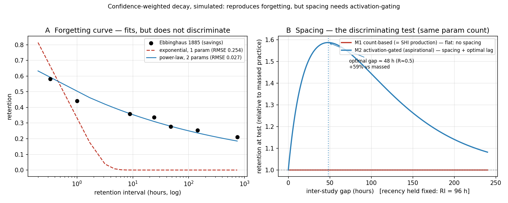
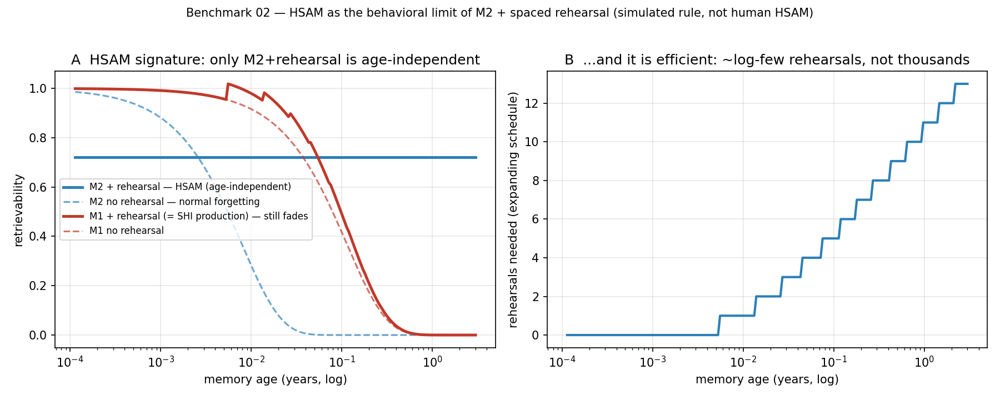
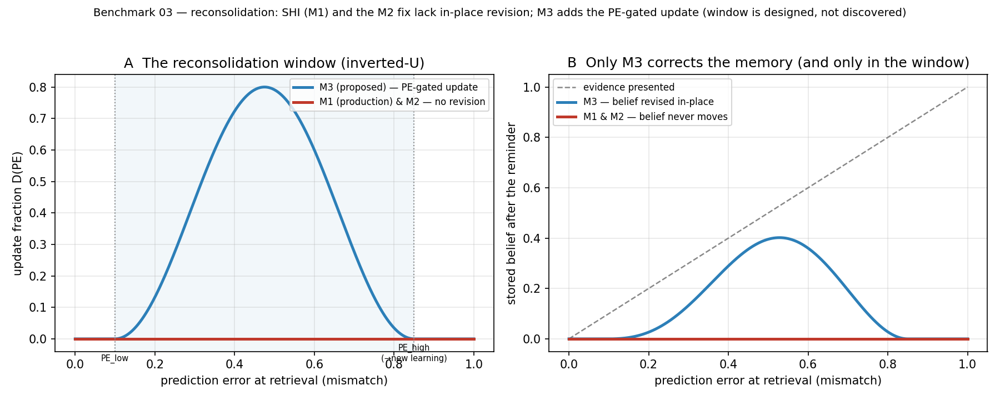

# glass-brain-bench

Open testing standards for synthetic-memory claims, companion to the essay
**"The Glass Brain"** (Saluca, 2026).

The essay argues something deliberately small: a legible, fully-instrumented
synthetic memory *could* be a cheap hypothesis-generator for the science of
memory, **only if** its claims are held to the same standard a memory lab would
hold them to. This repository is where that standard is enforced in runnable
code, so the claims can be re-run, attacked, and extended by anyone, rather than
taken on the author's word.

## How it works

Each benchmark is a script that compares memory rules with the same parameter count, prints its
numbers and draws one figure into `results/`. Arrows are imports and file writes, read from the
code. Benchmark 01 carries its own copy of the M1 and M2 equations; benchmarks 02 and 03 import
the reference models. The tests import either the reference models or benchmark 02 directly.



`soul-svc-port/` imports nothing from this repo. It is a staged change written against a separate,
private service; see [What is in this repo](#what-is-in-this-repo).

## What is in this repo

| Layer | In this repo | Licence | Where it lives |
|---|---|---|---|
| Benchmarks 01 to 03, reference models M2 and M3, tests, figures | yes | Apache-2.0 | `benchmarks/`, `reference/`, `tests/`, `results/` |
| Proposed M2 change for production (SQL migration, scoring drop-in) | yes, staged, not deployed | Apache-2.0 | `soul-svc-port/` |
| The production memory service the findings describe (`soul-svc/hybrid_search.py`, M1) | no | not public | a private Saluca repository; quoted in this README and `STATUS.md` from a reading of its code |
| The essay "The Glass Brain" | no | not recorded | no public link recorded yet |

An agent can run and check everything in the first two rows. Claims about the production service
cannot be checked from this repository.

## Status

Research artifact. All three benchmarks and their nine tests run from a clean clone and reproduce
the numbers quoted below (re-run 2026-10-22). Each benchmark is a simulation of a rule, not a
measurement of a deployed system: the M2 fix is validated in `reference/` and `tests/` only, and the
proposed production change in `soul-svc-port/` is staged, not applied, as of the last update to
[`STATUS.md`](STATUS.md). Benchmarks 04 and 05 are backlog, not built.

## Install

Tested 2026-10-22 on Python 3.12.10 with numpy 2.5.4, scipy 1.18.1, matplotlib 3.11.2 (CI uses
Python 3.12).

```bash
git clone https://github.com/saluca-labs/glass-brain-bench
cd glass-brain-bench
python -m venv .venv && . .venv/bin/activate      # Windows: .venv\Scripts\activate
pip install -r requirements.txt pytest
```

## Quickstart

```bash
python benchmarks/forgetting_spacing.py     # writes results/forgetting_spacing.png
```

Output from a clean clone on 2026-10-22:

```
exp fit: half-life h=0.67 h, RMSE=0.2541
pow fit: S=0.010, beta=0.150, RMSE=0.0268
M1 count-based spacing range (normalized): 0.00e+00  (= flat, no spacing)
M2 activation-gated: optimal gap=48.1 h (=H0), peak/massed=1.587x, improvement=+58.7% vs massed
```

A last line, `saved: <your clone>/results/forgetting_spacing.png`, prints the absolute path of the
figure; it is left out here because it shows the local directory.

## Usage

```bash
python -m pytest -v tests                    # 9 tests, 3 per benchmark
python benchmarks/forgetting_spacing.py      # 01, writes results/forgetting_spacing.png
python benchmarks/hsam_rehearsal.py          # 02, writes results/hsam_rehearsal.png
python benchmarks/reconsolidation.py         # 03, writes results/reconsolidation.png
```

On 2026-10-22 the tests reported `9 passed`. Benchmark 02 printed, among its lines,
`M2 + rehearsal : retrievability 0.721  (13 rehearsals over 3y)` and
`M2-rehearsed age-independence (3y / 1h ratio): 1.000  (~1 = flat = HSAM)`. Benchmark 03 printed
`M1/M2 update fraction across all PE: max=0.000  (= no reconsolidation, ever)`. Running a
benchmark overwrites its figure in `results/`, which is checked in as the published record; do not
commit a regenerated figure unless the benchmark itself changed.

## The standard

Every benchmark here obeys the same rules. They exist to stop a memory model
from looking better than it is.

1. **Declared parameter count, fixed before looking at the human data.** No
   fitting a model to a phenomenon and then calling the fit a prediction.
2. **Confounds controlled by design, not by hope.** Spacing tests hold recency
   fixed; otherwise a "spacing effect" is just a recency effect in disguise.
3. **Same parameter count across compared models**, differing only in the
   mechanism, so any difference is attributable to the mechanism and not to one
   model having more freedom.
4. **Honest negatives are results.** A rule that fails a benchmark has *located a
   gap* in the artifact. That is the point. We publish the failures.
5. **No borrowed credibility.** A result inside a simulated artifact is a fact
   about the artifact, never evidence about biology, until a wet lab confirms it.

## Benchmarks

| # | file | tests | status |
|---|------|-------|--------|
| 01 | `benchmarks/forgetting_spacing.py` | Ebbinghaus forgetting curve + spacing effect | **run**, see finding below |
| 02 | `benchmarks/hsam_rehearsal.py` | HSAM: age-independent recall via rehearsal | **run**, M2-only, see finding below |
| 03 | `benchmarks/reconsolidation.py` | reconsolidation: prediction-error update window | **run**, located gap, see finding below |

### Benchmark 01 finding (2026-06-11)

Two models, same two parameters, differing only in the update rule:

- **M1 "count-based":** a corroboration multiplies stability by a fixed factor,
  independent of the memory's current state.
- **M2 "activation-gated":** the gain from a corroboration depends on how
  retrievable the memory was when it was corroborated (expected gain ∝ R·(1−R)).

Result: a flexible decay fits the forgetting curve (not discriminating; a single
exponential actually *fails* the heavy tail, a power-law fits). The discriminating
test is spacing, with recency controlled: **M1 produces no spacing effect at all**
(stability depends on corroboration *count*, not timing); **only M2 produces the
spacing effect and its nonmonotonic optimal lag.**

This is what the production system does. SHI's live memory model
(`soul-svc/hybrid_search.py`) scores retrievability as

```
score = exp(-λ · age_since_encoding) × (1 + ln(1 + recall_count) / 10) × tier
```

That is a single fixed-timescale decay anchored to encoding, times a recall term that
is a function of **count alone**. That is M1, literally. So the production system,
as built, reproduces neither the spacing effect nor the shape of the forgetting
curve. The benchmark located a real, confirmed gap in the artifact.

> Scope: this is a memory-*retrieval ranking* function, engineered for search
> relevance, not built to model human retention. The claim is not "SHI tried to be
> brain-like and failed." The claim is narrower: the documented rule
> ("persistence is a function of corroboration") is, in code, literally a function
> of corroboration *count*, and that rule does not reproduce these phenomena.

### Benchmark 02 finding (2026-06-11)

Motivated by the 60 Minutes "Endless Memory" segment on HSAM (people who recall
essentially every day of their life, *age-independently*). The claim under test:
HSAM is not special storage, it is the behavioral limit of **M2 + chronic
rehearsal** over a lossless store, because under M2 each recall resets the decay
clock and grows stability, so a memory rehearsed on a spaced schedule becomes
permanently retrievable.

Result (`tests/test_hsam.py`, 3/3): under M2, a rehearsed memory's retrievability
is **age-independent**: a 3-year-old memory scores the same as a fresh one (3y/1h
ratio = 1.00), and it takes only **~13 well-timed rehearsals over 3 years**
(an expanding/spaced schedule), not thousands. The same rehearsal under **M1
(production)** decays to ~5e-12 at 3 years: because M1's decay is anchored to
*encoding* and never reset by recall, rehearsal cannot sustain old memories. So
HSAM-like total recall is reachable under M2 and unreachable under the live rule,
which both demonstrates the claim and re-confirms the production gap from a second
angle.

Scope: this mimics the *coverage* (age-independent retrievability), not the
reconstructive re-living human HSAM subjects describe, and forgetting is adaptive,
so a non-decaying tier is a deliberate trade, not a free upgrade.

### Benchmark 03 finding (2026-06-11)

Human memory revises a stored belief at retrieval only within a *window* of
prediction error: none if the reminder matches (nothing to learn), maximal at
moderate mismatch, and none again if the mismatch is large enough to be treated as
a new event (Sevenster 2013/2014; Sinclair & Barense 2019).

The honest finding here is **not** "we reproduced the inverted-U"; that curve is
*designed* into M3 to match those boundary conditions. The finding is the **located
gap**: SHI today (M1) **and** the M2 durability/spacing fix have **no in-place
revision at all** (`tests/test_reconsolidation.py`, 3/3: M1/M2 update fraction = 0
across the entire PE range). A recall may strengthen a memory (M2) or bump a count
(M1), but it never moves a stored belief toward contradicting evidence. So the
system can only *append* corrections, never *correct in place*, so stale or wrong
memories persist. Reconsolidation is a distinct gap from forgetting/spacing, and
M3 (`reference/m3_reconsolidation.py`) is the minimal mechanism that closes it: a
prediction-error-gated update, nonmonotonic as biology requires (necessary PE to
destabilize; too much PE → new memory, old one intact).

This one is **not yet in `soul-svc-port/`**; it is a larger change (it needs a
content/embedding comparison at retrieval to compute PE), tracked as future work.

## The trajectory

This repo exists to move, in public and in order:

1. **here is the gap:** benchmark 01, done.
2. **here is the aspirational fix:** M2: gate the corroboration increment on
   retrievability at recall, and let a successful recall reset/extend the decay
   clock (testing effect). The spacing effect falls out. **Reference
   implementation built and validated** (`reference/m2_memory.py`, `tests/`,
   3/3 passing); production deploy **staged** in `soul-svc-port/`, *not yet
   applied*. See `STATUS.md`.
3. **here is the code that closes it:** the M2 mechanism shipped into the live
   memory layer, re-run against this benchmark on **real data**, demonstrated not
   asserted. Not done.

## Architecture

| Path | What it holds |
|---|---|
| `benchmarks/` | the three benchmarks; each prints its numbers and writes a figure to `results/` |
| `reference/m2_memory.py` | M2, the activation-gated, testing-effect reference model |
| `reference/m3_reconsolidation.py` | M3, the prediction-error-gated in-place update |
| `tests/` | `test_m2_spacing.py`, `test_hsam.py`, `test_reconsolidation.py`, 3 tests each |
| `results/` | the published figures, one per benchmark |
| `soul-svc-port/` | the staged production change for M2 (a SQL migration and a scoring drop-in), not deployed |
| `STATUS.md` | where each claim sits on the gap, fix, shipped-code trajectory |

Each benchmark compares models with the same parameter count that differ only in one mechanism
(M1 count-based, M2 activation-gated, M3 reconsolidation), so a difference in the output is
attributable to that mechanism.

## Screenshots

The figures each benchmark writes. Re-generated from a clean clone on 2026-10-22, they match the
checked-in copies below (font rendering aside).







## Citation

No archived record yet.

## License

Apache License 2.0 (SPDX: `Apache-2.0`), Copyright 2026 Saluca Labs, LLC. See [`LICENSE`](LICENSE)
and [`NOTICE`](NOTICE).

Apache-2.0 is chosen deliberately over a more minimal license: its explicit
patent grant lets anyone adopt and build on this testing standard without
ambiguity about Saluca's patent portfolio. The standard is only useful if it is
genuinely free to take.

## Links

- [`STATUS.md`](STATUS.md): the status of each claim and the backlog
- [`soul-svc-port/README.md`](soul-svc-port/README.md): the deploy and validation checklist for M2
- The essay "The Glass Brain" (Saluca, 2026): no public link is recorded in this repository yet.

_Last updated: 2026-10-22_
